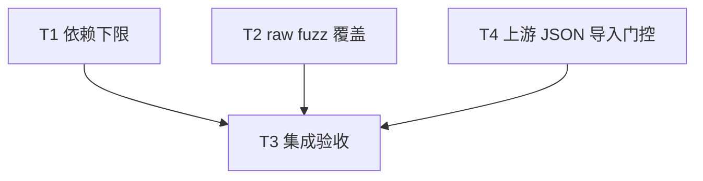

# rs-value 依赖下限与原始输入 fuzz 改进实施计划

> **面向智能体执行者：** 按本计划逐项实施，以复选框跟踪；可使用 executing-plans。未来实施命令决定操作授权，不由本文授予提交或推送权限。

**目标：** 完成 RV-005 的最低依赖修正与 RV-006 的原始输入 fuzz 覆盖扩展。

**架构：** 根清单只收紧 bigdecimal 下限；现有 raw fuzz binary 复用 fuzz crate 内部 helper，执行小输入、宽输入和变化结构预算三个档位。生产值模型、Wire schema 和默认预算不变。

**技术栈：** Rust 2024、Rust 1.94.0、Cargo、qubit-value、qubit-budget、qubit-json、libfuzzer-sys、cargo-fuzz 0.13.2、nightly-2026-06-05。

**文档位置：** 用户指定的项目 doc 目录；不使用技能默认临时文档目录，不创建新的 Paseo workspace。

**设计依据：** [本轮设计](design-20261030T175816388Z-fee6de26.md)。基线 HEAD 为 `27c597ef3a2ba64ac3e77b8677fab0236c859834`，实施前重新核对。

## 纳入范围与全局约束

- 纳入 RV-005（P2，依赖下限与源码要求不一致）和 RV-006（P3，原始输入 fuzz 覆盖不足）。没有用户明确搁置或拒绝项。
- 此前 RV-001～RV-004 不作为本轮新增工作，不重复实施旧设计。
- 实施中新增用户授权 T4：修复 rs-datatype 两处 JSON helper 导入门控，验证、单独提交后重跑 rs-value CI。
- 始终使用中文回复；新增 Rust 注释遵循项目现有英文约定。
- 仅修改当前任务直接相关内容，不顺手重构、格式化或清理。
- CI 只验证当前 crate，不加入或保留下游 all-features 测试。
- 沿用当前 Paseo workspace，不创建或打开新的 Paseo workspace。
- 方案生成阶段只产出两份指定文档，该阶段在文档核对完成时结束。下面的代码修改和验证均属于后续实施阶段；提交等操作取决于届时授权。
- 修改 Rust/测试前读取用户全局规则指定的对应规则；执行 Git 写操作前读取 `~/.agents/specs/git.mdc`。最低版本验证失败若确认为缺陷，再读取适用的 bug-fix 规则。不要为此次清单修改另建生产兼容层。

## 调度图

| 任务 | 前置任务 | 最小解锁产物 | 写入集合 | 本地验证 | 集成验证归属 | 审查时机 |
| --- | --- | --- | --- | --- | --- | --- |
| T1：依赖下限 | 无；与 T2 同一可并行批次 | 根清单下限与最低版本证据 | `Cargo.toml`；仓库外可丢弃消费者 | 0.4.7 两组 feature 的 check、metadata | T3 | 立即审查 |
| T2：raw fuzz 覆盖 | 无；与 T1 同一可并行批次 | helper、入口、回归与语料 | `fuzz/src/lib.rs`、新 `fuzz/src/bounded_wire_input.rs`、`fuzz/fuzz_targets/bounded_value_wire_v1.rs`、新 `fuzz/tests/bounded_wire_input_tests.rs`、设计列明四个新 corpus 路径 | `cargo test --locked --manifest-path fuzz/Cargo.toml --test bounded_wire_input_tests` | T3 | 批量审查 |
| T4：上游门控修复 | 无；完整 CI 阻塞后新增授权 | 两处门控及聚焦验证、独立提交 | rs-datatype 的 `src/converter/conversion_session.rs` | converter / converter,json check；ConversionSession 聚焦测试 | T3 重跑 rs-value CI | 立即审查 |
| T3：集成验收 | T1、T2、T4 | 两项代码与局部验证已完成 | 仅允许修正 T1/T2 直接相关文件和实际必要 lockfile | 汇总局部证据和最终 diff | 本任务独占全套 CI、根测试、fuzz smoke | 立即审查 |

T1/T2 写入集合不相交，可并行；默认主执行者也可顺序完成，不要求创建 agent。最低版本消费者使用独立 target；T2 和 T3 的 fuzz target/cache 属于同一资源组，重型命令串行。下表中最小解锁产物不要求先提交才能继续。

## 任务拓扑依赖图



## T1：修正并验证 bigdecimal 下限

**文件：** 修改根 `Cargo.toml:129`。默认不修改根或 fuzz lockfile，不改兄弟项目。

**接口：** 将本 crate 对 bigdecimal 的要求改为 `^0.4.7`；不改 Rust API。T3 消费清单和最低版本证据。

- [x] 核对当前清单、HEAD、已有工作；保留用户文件。确认使用 `as_bigint_and_scale()` 的路径仍存在。
- [x] 在仓库外准备一次性最低版本消费者，使用下面的完整清单，`src/lib.rs` 内容为 `pub use qubit_value::Value;`。从当前项目目录执行，临时目录通过 `mktemp -d` 创建，不能把它误认为新的 Paseo workspace。

```toml
[package]
name = "rs-value-minimum-bigdecimal-check"
version = "0.0.0"
edition = "2024"

[workspace]

[features]
json-converter = ["qubit-value/json", "qubit-value/converter"]

[dependencies]
qubit-value = { path = "/data/working/qubit/rust-common/rs-value", default-features = false, features = ["big-decimal"] }
bigdecimal = "=0.4.7"
```

- [x] 修改根清单，仅替换这一行：

```toml
bigdecimal = { version = "^0.4.7", optional = true }
```

- [x] 用临时目录变量 `minimum_dir` 运行两组编译并读取解析图。此处命令属于实施步骤，不在方案生成阶段执行。

```bash
CARGO_TARGET_DIR="$minimum_dir/target" cargo check --manifest-path "$minimum_dir/Cargo.toml"
CARGO_TARGET_DIR="$minimum_dir/target" cargo check --locked --manifest-path "$minimum_dir/Cargo.toml" --features json-converter
cargo metadata --locked --manifest-path "$minimum_dir/Cargo.toml" --features json-converter --format-version 1
```

预期：两组编译退出码均为 0；metadata 中所有名为 bigdecimal 的 package 版本集合精确为 `{0.4.7}`。消费者初次解析允许联网；离线缺包不是依赖 API 不兼容证据。若传递依赖阻止解析，保留错误并定位原因，不默认为 rs-value 修正已成功。

- [x] 最低版本声明用编译证据验证，不为单行清单变化新增字符串匹配测试。原始声明不足的证据来自本轮上游源码核对；不要求为制造失败改动源码或降级项目 lockfile。
- [x] 检查根和 fuzz lockfile 是否仍满足约束；若满足则保持原样，若实际需要更新只保留相关解析变化。记录受影响调用方的迁移说明：旧锁定应用更新 bigdecimal，源代码无需迁移。

## T2：扩展原始输入 fuzz 并建立确定性回归

**文件与职责：** 按设计第 4.2 节的八个路径执行。现有 fuzz crate 可导出 helper，根 crate 不新增 API。保留原目标名称及已有 corpus。

**接口：** 新增 `qubit_value_fuzz::bounded_wire_input::check_input(data: &[u8]) -> bool`，返回宽档位成功标志；入口调用它，测试断言它。

- [x] 先添加长合法输入回归，新增测试文件的第一组核心用例如下。helper 尚不存在时应编译失败；实现存在后应验证长输入被宽档位接纳，不仅仅是“不 panic”。

```rust
use qubit_value_fuzz::bounded_wire_input::check_input;

#[test]
fn test_long_document_reaches_wide_decode_and_round_trips() {
    let input = format!(
        r#"{{"version":1,"value":{{"scalar":{{"string":"{}"}}}}}}"#,
        "x".repeat(256),
    );
    assert!(input.len() > 94);
    assert!(check_input(input.as_bytes()));
}
```

- [x] 新增 helper，固定常量 `SMALL_INPUT_BYTES=94`、`WIDE_INPUT_BYTES=4096`、`ROUND_TRIP_BYTES=65536`。用下列算法生成变化档位（放入 helper，不在生产 crate 增加类型）：

```rust
fn selector(data: &[u8], offset: usize) -> usize {
    usize::from(data.iter().skip(offset).step_by(4)
        .fold(0_u8, |sum, byte| sum.wrapping_add(*byte)))
}

fn varied_decode_limits(data: &[u8]) -> qubit_budget::json::JsonDecodeLimits {
    use qubit_budget::json::JsonDecodeLimits;
    use qubit_value::ValueWireV1;
    let depth = [0_usize, 1, 4, 8, 16, 64];
    let nodes = [0_usize, 1, 8, 32, 128, 4096];
    let items = [0_usize, 1, 2, 8, 32, 4096];
    let base = ValueWireV1::default_json_decode_limits();
    let values = base.into_value_limits().into_builder()
        .max_depth(depth[selector(data, 0) % depth.len()])
        .max_nodes(nodes[selector(data, 1) % nodes.len()])
        .max_sequence_items(items[selector(data, 2) % items.len()])
        .max_map_entries(items[selector(data, 3) % items.len()])
        .build();
    JsonDecodeLimits::builder()
        .max_input_bytes(4096_usize)
        .value_limits(values)
        .build()
}
```

已从当前解析的 qubit-budget 0.10.0 源码核对 `JsonValueLimits::into_builder()` 和四个 builder 方法；该转换保留 string/key/number/payload 的既有限制，不需要逐项重建默认 profile。

- [x] 将当前目标的 decode/match/roundtrip 主体迁入 helper 的私有 `check_profile(data, limits) -> bool`：成功执行 64 KiB 编码及默认 value profile 的 64 KiB 解码，断言 identity 相等并返回 true；四类预期错误返回 false，其他错误 panic。原先超长检查改为按本档 `limits.max_input_bytes()` 精确检查 `JsonResource::InputBytes`，同时处理 `BudgetError::LimitExceeded` 和 `Insufficient`。
- [x] 实现 `check_input` 顺序调用小档位、宽档位、结构变化档位；返回宽档位成功标志。每次调用独立 session，任何档位正常拒绝都不跳过后续档位。保留完整输入，不截断或消费控制头。
- [x] 更新 `fuzz/src/lib.rs` 增加 `pub mod bounded_wire_input;`。现有目标保留版权头、`#![no_main]`，主体缩为：

```rust
use libfuzzer_sys::fuzz_target;
use qubit_value_fuzz::bounded_wire_input::check_input;

fuzz_target!(|data: &[u8]| {
    let _ = check_input(data);
});
```

- [x] 补全以下确定性回归矩阵。资源错误断言沿用根 `tests/value_wire/value_wire_v1_tests.rs::test_value_wire_v1_decoding_honors_structural_budgets` 的模式，匹配结构化资源，不比较消息文本。

| 用例 | 输入构造 | 限制与预期 |
| --- | --- | --- |
| 输入边界 | 合法 scalar Int32 文档后补空格到 94/95/4096/4097 字节 | 94 档和 4096 档各自边界成功，越界为 InputBytes；check_input 的宽档位布尔值相符 |
| 深度 | scalar Json 的 payload 用 65 个数组包住 null | 宽档默认 Depth 拒绝；较浅夹具在低 depth 拒绝、提高 depth 后成功 |
| 节点 | Int32 集合 `[1,2,3]` | 仅收紧 max_nodes 至 1，Nodes 拒绝；放宽至 64 后成功 |
| 序列项 | Int32 集合 `[1,2,3]` | 仅 max_sequence_items=2，SequenceItems 拒绝；=3 成功 |
| map 项 | scalar Json payload `{"a":1,"b":2,"c":3}` | 仅 max_map_entries=2，MapEntries 拒绝；=3 成功，外层记录最多两个字段不干扰 |
| 重复键 | scalar Json payload 含 256 字符串及两个同名 key | 宽档为 InvalidJson，不能为 InputBytes |
| 畸形尾部 | 合法长字符串文档去掉最后一个右花括号 | 宽档为 Syntax，不能为 InputBytes |
| 档位可达 | 四组 selector 分别输入 `{0,1,2,3,4,5}`，其他分组填零 | 四个维度各自能选择全部六个值；断言 profile 字段 |

若需测试私有 profile/selector，在 helper 的 inline test module 中实现；公共 check_input 的回归留在新 integration test 文件。不要仅验证所设置字段来替代实际 decoder 资源拒绝用例。

- [x] 添加四份语料。`long-string` 为上述 256 字符串；`nested-array` 使用 scalar Json 的 12 层数组包裹 null；`duplicate-key` 为上表的长重复键文档；`malformed-tail` 为长字符串文档删除最后一个右花括号后的字节。新文件均使用原始 JSON 字节，先检查路径未占用，保留现有四份语料。
- [x] 运行 focused 测试，预期全部通过。helper 私有选择器测试需同时运行 lib tests：

```bash
cargo test --locked --manifest-path fuzz/Cargo.toml --lib --test bounded_wire_input_tests
```

仅在新增实际依赖导致 lockfile 必须更新时才允许相关更新；本方案不新增依赖，预期无需更新。短时 fuzz 留给 T3，不在此重复执行。

## T4：用户新增授权的上游最小修复

**授权原文：** “授权最小依赖修复并重跑 CI”。该任务是在首次 rs-value 全量 CI 发现上游既有缺陷后新增；不撤销原有范围限制，只增加这个具体修复。

**文件：** `/data/working/qubit/rust-common/rs-datatype/src/converter/conversion_session.rs`，在独立 Git worktree 实施。

- [x] 确认 rs-datatype 工作树干净，记录原分支 `dev-starfish` 和 HEAD `fb307a8`；converter-only check 退出 101，错误为两个无条件 JSON helper 导入 E0432。
- [x] 对两个导入分别添加 `#[cfg(feature = "json")]`，不修改其他源码、测试、feature 或依赖。
- [x] 两组 `cargo check --locked --no-default-features --features converter` / `converter,json` 通过；单文件 rustfmt 检查和 diff-check 通过。
- [x] `cargo test --locked --no-default-features --features converter --test lib_tests conversion_session` 聚焦回归通过（11 项）。
- [x] 独立审查核对定义、重导出及所有调用方门控一致，无实质问题。
- [x] 仅提交此两行变更并合回 rs-datatype 原 `dev-starfish`；不批量同步原有 5 个未推送提交。提交为 `7000509bf50175cba98a8f9d1814a5448e54698b`。
- [x] 返回 T3，已启动 rs-value 完整 CI 重跑，结果仍待核对。

## T3：集成验证与最终检查

**输入：** T1 下限和最低版本证据、T2 helper/目标/回归/语料，以及 T4 已验证并单独提交的上游修复。

**写入边界：** 只修正前两项直接相关文件；不重写此前设计，不处理偶遇的无关风格问题。

- [x] 复核 T1 最低版本解析图与两组 check 均真实通过；复核 T2 首次失败与最终通过证据。确认长输入的 true 返回值、精确资源类别及实际档位可达性。
- [x] 检查最终 diff 和新增文件，确认没有改变生产解析语义、Wire 格式或默认预算，根 lockfile 无无关变化；确认 workflow 仍只针对当前 crate。
- [x] 主执行者集中运行根 crate 测试和独立 fuzz crate 测试：

```bash
cargo test --locked --no-default-features --features big-decimal,json,converter
cargo test --locked --all-features
cargo test --locked --manifest-path fuzz/Cargo.toml --lib --tests
```

- [x] 使用既有工具链执行单一原始输入目标 30 秒 smoke：

```bash
cargo +nightly-2026-06-05 fuzz run bounded_value_wire_v1 -- -max_total_time=30 -max_len=4096
```

从项目根目录使用 cargo-fuzz 的既有 fuzz 目录发现机制。若工具版本或依赖缺失，按项目流程准备并记录；不能把缺少工具写成测试通过。运行过程新增的可丢弃 corpus/cache 按实际对象判断处理，不覆盖或删除用户语料。崩溃样本保留用于定位。

- [x] 在工作树稳定后运行当前 crate 的既有 CI 门禁；该命令是昂贵检查的唯一所有者，不由 T1/T2 重复运行：

```bash
./.infra/bin/ci-check.sh
```

若仓库规范要求先 alignment/style-check，按实际规范执行并检查 diff，只保留本任务相关修改；不要因工具机械变化而扩大重构。门禁内部可能重复部分根测试，单独的 focused 命令仍用于明确本轮覆盖证据，不额外循环运行全套验证。

- [x] 报告命令、退出码、失败或未执行原因、实际最低版本、测试覆盖边界和剩余问题。有限 smoke 只能证明该次运行未发现崩溃，不能宣称不存在解码缺陷。
- [x] 检查实施授权后决定是否进行 Git 写操作；若获授权，按规则整理与本轮相关的变更。该步骤不要求用户额外审阅或审批设计，亦不把当前方案阶段限制带入未来实施。

## 需求映射与计划自检

| 必须项 | 任务与验收 |
| --- | --- |
| 全部本轮采纳项、无拒绝项 | T1=RV-005；T2=RV-006；T3 汇总 |
| 最小依赖修正与真实最低版本 | T1 单行变更、精确版本消费者及 metadata |
| 原始输入更宽探索、保留小档位 | T2 三档及宽档成功回归 |
| 结构资源临界与拒绝分类 | T2 四维实际拒绝/接纳、输入边界和语料 |
| 不改生产契约、不加入下游 all-features CI | T3 diff 与 workflow 检查 |
| 任务依赖、写入集合、验证归属一致 | T1/T2/T4 → T3；全量验证归 T3 |
| 用户新增上游最小修复授权 | T4 两处门控、编译回归、11 项聚焦测试及独立提交 |
| 阶段边界和操作授权 | 文档头及 T3 最后一步，未来实施命令决定授权 |

方案交付时已核对任务表、拓扑与正文使用同一组 T1/T2/T3。方案交付时实施复选框全部未勾选；当前勾选状态依据下面的实际执行记录，未勾选门禁仍待完成。

## 实施记录：上游最小修复已获授权，继续集成

- 实施 worktree：`/data/working/qubit/rust-common/rs-value/.worktrees/rv005006/rs-value`，分支 `fix/rv005006`；原分支 `dev-starfish` 保留。没有创建新的 Paseo workspace。
- T1 已完成：清单下限为 `^0.4.7`；仓库外精确 `=0.4.7` 消费者两组 check 均退出 0，metadata 确认唯一版本 0.4.7。根和 fuzz lockfile 均未修改。证据目录 `/tmp/rs-value-minimum-bigdecimal-tnTAiK`。
- T2 已完成：先取得缺 helper 模块的预期编译失败，再实现三档与全部回归；2 个 inline 和 10 个新集成测试通过。
- 基线 `cargo test --locked --lib`：9 项通过。根组合 `big-decimal,json,converter`：842 项测试及文档测试通过；根 all-features：969 项通过；独立 fuzz crate `--lib --tests`：15 项通过。三个命令退出码均为 0。组合构建有既有测试文件的 unused-import 警告，没有扩展修复这些文件。
- 独立审查：T1 审查和整体验证前的独立审查均无实质问题；源码摘要核对确认后续未改变已审实现。
- `./.infra/bin/align-ci.sh`：退出 0。
- 原始输入 fuzz smoke：`cargo +nightly-2026-06-05 fuzz run bounded_value_wire_v1 <仓库外语料副本> -- -max_total_time=30 -max_len=4096`，退出 0，实际 31 秒、448019 次执行，无崩溃。原始语料没有被本次运行覆盖或混入生成样本。有限 smoke 不证明不存在缺陷。
- `./.infra/bin/ci-check.sh`：退出 1；此前普通测试套件和已执行矩阵配置通过，但 converter-only 在依赖 rs-datatype 编译失败，完整 CI 尚未通过。
- 失败证据：rs-datatype 干净 HEAD `fb307a8` 的 `src/converter/conversion_session.rs:44–45` 无条件导入 `map_json_decode_error`、`map_json_encode_error`，对应 internal re-export 却受 `json` gate 限制。错误为 E0432，命令为 `cargo +1.94.0 check --workspace --no-default-features --features converter`。这不是本轮 rs-value 的源码改动。
- 新发现的 rs-datatype 独立缺陷不自动记为 RV-005/RV-006 已采纳内容。已请求用户决定是否授权两处 `#[cfg(feature = "json")]` 最小修复及该仓库验证/提交，或保持原范围并记录外部阻塞。未收到回复前不应用上游补丁；补丁可应用性检查已通过。
- 完整 CI 和 Git 集成尚未完成，没有执行 add、commit 或 push。保留所有工作树和证据；原有 e3583a4a 两份未跟踪文档保持原样。
- 续做顺序：读取用户范围决定 → 若授权，重新核对 rs-datatype 状态并修复验证及独立审查 → 重跑 rs-value 完整 CI → 按实施授权完成 Git 集成；若明确保持原范围，则记录完整 CI 外部阻塞并按用户决定收尾，不声称 CI 通过。
- 主线程日志与续做记录：`/tmp/superpowers-sdd-1000-5a99b2b9ca000785ed65/sdd/`。

### 用户回复后的续做状态

- 用户已选择“授权最小依赖修复并重跑 CI”，此前等待已解除；T4 已纳入调度表、拓扑和任务正文。
- rs-datatype 隔离工作树：`/data/working/qubit/rust-common/rs-value/.worktrees/rv005006/rs-datatype`，分支 `fix/rs-value-json-gates`，取代本任务先前创建的同名临时依赖符号链接，原项目文件未被移除。
- 两个 check 已通过（退出 0），独立审查无实质问题，正在运行 ConversionSession 聚焦测试。此前“未收到回复前不应用”属于历史等待状态，现已按明确授权应用两处门控。

## 实现与验证收口记录

以下为代码提交时核对的最终实现/验证结果，取代此前等待状态；先前 CI 失败与授权记录保留作为历史证据。

- RV-005：`86f321a`，只收紧 bigdecimal 下限。上游修复后再次执行两组精确 0.4.7 的离线 locked check，均退出 0。
- RV-006：`918e4c7`，八个指定 fuzz 文件；三档、所有回归和四份新增语料齐全。
- T4：`7000509` 已合回 rs-datatype 原 `dev-starfish`，只增加两行 cfg。converter-only 与 converter/json check、11 项会话测试、单文件格式检查和独立审查通过。该仓库原有 5 个未推送提交保持原状，未批量同步到其他分支或远端。
- rs-value 独立实现审查与 T4 独立审查均无实质问题；没有遗留实现缺口或未确认疑点。
- `./.infra/bin/align-ci.sh` 退出 0；上游修复后重跑的 `./.infra/bin/ci-check.sh` 退出 0，包含 feature 矩阵、三个 fuzz 目标、打包、覆盖率与审计。此前 E0432 阻塞已经解除，不再处于等待用户输入状态。
- 独立验证保留：根组合 842 项、all-features 969 项、fuzz crate 15 项均通过；原始输入目标 31 秒 448019 次执行无崩溃。有限 smoke 不构成不存在缺陷的证明。
- 本轮 CI 自动生成的 1992 份哈希命名语料已按任务范围清理，保留全部原语料和四份指定新语料，共 11 份。没有删除源码或用户数据。
- 临时 SDD 证据目录在 CI 期间被清理，完整重跑日志已从运行进程的打开文件恢复；较早命令结果以会话输出和本文记录为准。
- 可保留的验证证据缓存：`/home/starfish/.cache/qubit/implementation-evidence/rs-value-rv005006-h5zulxfv`，包含完整 CI 重跑日志、最低版本构建日志/metadata 和 CI 生成的摘要。
- Git 收尾由当前实施流程继续完成：本轮两份方案文档单独提交，rs-value 实现分支合回原分支，按授权同步分支并清理本任务创建的隔离工作树。实际合并/推送结果以最终交付答复为准，不将收尾操作未执行时写成已成功。
